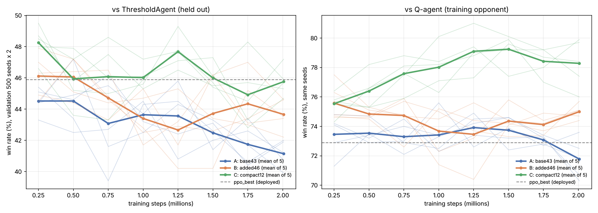

# P(bust)/E(draw) feature ablation — results

Arms: A = base43 (current), B = added46 (+P(bust), E(draw), cards left), C = compact12. Stage 1 recipe vs Q-agent, 2M steps, seeds [0, 1, 2, 3, 4]. Units = runs. P1 = full games vs ThresholdAgent (2,500 seeds x 2).

## Final checkpoints

| metric | ppo_best | A mean [95% CI] | B mean [95% CI] | C mean [95% CI] | B−A (p) | C−B (95% CI) |
|---|---|---|---|---|---|---|
| P1 | 0.445 | 0.426 [0.418, 0.434] | 0.448 [0.437, 0.459] | 0.471 [0.457, 0.485] | +0.022 (0.00308) | +0.023 [+0.008, +0.038] |
| P2 | 0.453 | 0.452 [0.437, 0.466] | 0.471 [0.466, 0.476] | 0.478 [0.470, 0.486] | +0.020 (0.0163) | +0.007 [-0.001, +0.015] |
| h2h_ppo_best | 0.500 | 0.487 [0.472, 0.502] | 0.511 [0.488, 0.534] | 0.545 [0.537, 0.554] | +0.024 (0.0479) | +0.034 [+0.012, +0.057] |
| q_agent | 0.755 | 0.720 [0.709, 0.730] | 0.725 [0.711, 0.740] | 0.771 [0.758, 0.784] | +0.005 (0.437) | +0.046 [+0.029, +0.062] |
| random | 0.947 | 0.954 [0.946, 0.961] | 0.953 [0.950, 0.956] | 0.964 [0.961, 0.968] | -0.001 (0.844) | +0.011 [+0.008, +0.015] |
| mistake_rate | 0.091 | 0.094 [0.085, 0.104] | 0.081 [0.074, 0.088] | 0.050 [0.042, 0.058] | -0.013 (0.0172) | -0.031 [-0.040, -0.022] |

## Selected checkpoints

| metric | ppo_best | A mean [95% CI] | B mean [95% CI] | C mean [95% CI] | B−A (p) | C−B (95% CI) |
|---|---|---|---|---|---|---|
| P1 | 0.445 | 0.450 [0.433, 0.467] | 0.467 [0.447, 0.487] | 0.488 [0.481, 0.496] | +0.017 (0.102) | +0.021 [+0.002, +0.041] |
| P2 | 0.453 | 0.446 [0.437, 0.455] | 0.464 [0.459, 0.468] | 0.479 [0.470, 0.487] | +0.018 (0.00282) | +0.015 [+0.006, +0.023] |
| h2h_ppo_best | 0.500 | 0.505 [0.489, 0.521] | 0.522 [0.510, 0.535] | 0.555 [0.540, 0.571] | +0.017 (0.0491) | +0.033 [+0.016, +0.049] |
| q_agent | 0.755 | 0.729 [0.724, 0.734] | 0.732 [0.721, 0.743] | 0.752 [0.728, 0.776] | +0.003 (0.553) | +0.020 [-0.004, +0.043] |
| random | 0.947 | 0.954 [0.947, 0.961] | 0.955 [0.950, 0.960] | 0.964 [0.960, 0.968] | +0.001 (0.828) | +0.009 [+0.004, +0.015] |
| mistake_rate | 0.091 | 0.061 [0.024, 0.098] | 0.041 [-0.007, 0.090] | 0.032 [0.016, 0.047] | -0.020 (0.4) | -0.010 [-0.057, +0.038] |

## Pre-registered decisions (final checkpoints)

- Sanity: arm A P1 = 0.426 vs ppo_best 0.445
- **B vs A on P1**: +0.022, Welch p = 0.003083 → features help: **True**
- C − B on P1: +0.023, 95% CI [+0.008, +0.038] → C as good as B: **True**
- No-harm vs A: B {'q_agent': True, 'random': True}, C {'q_agent': True, 'random': True}

## Mistake rates by deck size (final checkpoints, mean over runs)

Share of clear decisions (|E(draw)| > 3) taken the wrong way, from the P1 games.

| model | bucket | wrong draws (EV < −3) | wrong stays (EV > 3) |
|---|---|---|---|
| ppo_best | <20 | 41.5% | 12.3% |
| ppo_best | 20-40 | 28.4% | 10.1% |
| ppo_best | 40+ | 11.0% | 3.4% |
| A | <20 | 39.9% | 13.7% |
| A | 20-40 | 28.3% | 9.8% |
| A | 40+ | 8.9% | 4.8% |
| B | <20 | 23.7% | 10.2% |
| B | 20-40 | 22.4% | 9.8% |
| B | 40+ | 8.0% | 4.3% |
| C | <20 | 28.1% | 13.3% |
| C | 20-40 | 18.3% | 6.4% |
| C | 40+ | 1.6% | 1.0% |

## Round-robin (row's win rate vs column, 1,000 seeds x 2)

| | A_s2:ckpt_500000 | B_s1:ckpt_250000 | C_s3:ckpt_250000 | ppo_best | threshold |
|---|---|---|---|---|---|
| A_s2:ckpt_500000 | — | 0.480 | 0.463 | 0.516 | 0.459 |
| B_s1:ckpt_250000 | 0.520 | — | 0.492 | 0.539 | 0.478 |
| C_s3:ckpt_250000 | 0.537 | 0.508 | — | 0.551 | 0.497 |
| ppo_best | 0.484 | 0.461 | 0.449 | — | 0.430 |
| threshold | 0.541 | 0.522 | 0.503 | 0.570 | — |

## Per-run detail

| run | selected ckpt | val (selected) | P1 final | P1 selected | train min |
|---|---|---|---|---|---|
| A_s0 | ckpt_750000 | 0.462 | 0.431 | 0.459 | 21 |
| A_s1 | ckpt_1250000 | 0.458 | 0.420 | 0.451 | 21 |
| A_s2 | ckpt_500000 | 0.472 | 0.434 | 0.457 | 18 |
| A_s3 | ckpt_250000 | 0.454 | 0.420 | 0.456 | 17 |
| A_s4 | ckpt_1000000 | 0.445 | 0.426 | 0.426 | 17 |
| B_s0 | ckpt_1750000 | 0.470 | 0.444 | 0.455 | 22 |
| B_s1 | ckpt_250000 | 0.479 | 0.455 | 0.477 | 18 |
| B_s2 | ckpt_500000 | 0.472 | 0.434 | 0.473 | 18 |
| B_s3 | ckpt_250000 | 0.470 | 0.452 | 0.485 | 18 |
| B_s4 | ckpt_1500000 | 0.462 | 0.454 | 0.447 | 18 |
| C_s0 | ckpt_1250000 | 0.478 | 0.482 | 0.491 | 22 |
| C_s1 | ckpt_250000 | 0.480 | 0.483 | 0.479 | 18 |
| C_s2 | ckpt_250000 | 0.487 | 0.466 | 0.487 | 18 |
| C_s3 | ckpt_250000 | 0.495 | 0.466 | 0.489 | 18 |
| C_s4 | ckpt_750000 | 0.486 | 0.457 | 0.496 | 18 |
